# Git4agents / MADGRIX

> **Git decides ancestry. MADGRIX decides canonicality.**

MADGRIX is a governed Git canonicalization protocol for autonomous software agents, built on Cloudflare Workers + Artifacts. Agents can create many candidate states concurrently; **only one exact software state that has earned evidence-bound authority may become canonical**.

```text
INTENT → WorkClaims → contender work → independent evidence
       → blind verification → VERDICT SEAM
       → CanonCap → exact-state promotion
       → signed, offline-verifiable history
```

Git records **what changed**. MADGRIX records **why work began, what authority existed, what was checked, why a state was authorized, and whether the exact reviewed state is the state that shipped**.

## The agent-era primitive: canonicality

Traditional Git authorization is actor-centric: *Alice may merge to main.* Autonomous agents need a narrower boundary.

### CanonCap — Canonicalization Capability

**Canonicality is a capability, not a branch permission.**

MADGRIX already enforced exact-state, single-use promotion permits. `madgrix-canoncap/v1` makes that authority explicit and content-addressed for agents, tooling, Mission Control and proof:

```text
this task
+ this baseline
+ this exact candidate SHA/tree
+ this evidence bundle
+ this policy
+ this destination repository
+ this exact destination HEAD
+ single use
────────────────────────────────────
= one right to canonicalize this state
```

If the candidate changes, its tree changes, evidence changes, policy changes, destination changes, the destination HEAD moves, or the capability is consumed, the old authority cannot authorize the write. A rebase creates a new SHA and therefore requires new evaluation and new authority.

The existing permit remains the enforcement object in `TaskAuthority`; CanonCap is the secret-free public descriptor of that already-enforced authority.

### Causal Proof Graph

Git answers: **what came before this commit?**

MADGRIX can additionally answer: **why did this exact SHA have the right to become canonical?**

```text
task intent
   ↓
WorkClaims
   ↓
composition
   ↓
independent evaluation
   ↓
verdict
   ↓
CanonCap
   ↓
signed promotion proof
   ↓
canonical SHA
```

Every node is content-addressed and the projection has a deterministic `causal_root`. It is explanatory/proof state only; it cannot grant authority or promote code.

### Conflict Capsule

A `CONFLICTED` composition is **not software that may ship**. MADGRIX projects that state as `madgrix-conflict-capsule/v1`: baseline, contributing SHAs, conflicting paths, agent/role/SHA metadata and source-excerpt digests, plus the mandatory rule that resolution creates a **new candidate SHA that must be re-evaluated**.

```text
CONFLICTED
  → candidate_sha = null
  → old authority invalid
  → new resolved SHA required
  → re-evaluation required
```

Raw conflict excerpts are not exported by the public capsule.

### Attack Lab

The protocol's security advantage is deliberately demoable instead of hidden in prose:

```bash
npm run attack:lab
```

Expected ending:

```text
26/26 adversarial trials passed
unauthorized canonical promotions: 0
ATTACK_LAB_VERIFIED
```

This is the existing local adversarial protocol harness made judge-readable; it is **not** presented as live Cloudflare fault injection.

Specs and the precise non-novelty boundary: [`docs/CANONICALITY_PRIMITIVES.md`](CANONICALITY_PRIMITIVES.md) · [`docs/CANONICALITY_PRIOR_ART.md`](CANONICALITY_PRIOR_ART.md)

## Live competition proof

MADGRIX has completed **four recorded end-to-end runs on real Cloudflare infrastructure**.

| Run | Task | Baseline | Reviewed / promoted SHA | Result |
|---|---|---|---|---|
| 1 | `task_0090714a…` | `7d6cb08` | `3b71d3a` | TheUstad `FINAL VERIFIED`, bundle `VERIFIED` |
| 2 | `task_6cdb2087…` | `3b71d3a` | `fc9c1e7` | TheUstad `FINAL VERIFIED`, bundle `VERIFIED` |
| 3 | `task_735cca4a…` | `fc9c1e7` | `b3ee4c86` | TheUstad `FINAL VERIFIED`, bundle `VERIFIED` |
| 4 | `task_79b1f9d6…` | `b3ee4c86` | `d55332b5` | `MADGRIX_LIVE_E2E_OK`, TheUstad `FINAL VERIFIED`, bundle `VERIFIED` |

Each run promoted onto the real `starter-repo` Artifacts `main`; each baseline was the previous run's promoted state. **The reviewed/authorized SHA and shipped SHA were identical in all four recorded successful runs.**

Run 4 is the competition source run:

```text
task       task_79b1f9d610e94d8e95daa503
baseline   b3ee4c862dcc6996678dc25c1de5c49b060fa9d4
reviewed   d55332b544992a2e033ca03fa54972c5283eef73
promoted   d55332b544992a2e033ca03fa54972c5283eef73
TheUstad   FINAL VERIFIED
orchestrator MADGRIX_LIVE_E2E_OK
offline bundle VERIFIED
```

The competition crew is **one parent coordinator plus two scripted sub-agents on one contender fork**. They demonstrate concurrent process coordination and authority; they are not presented as evidence of LLM coding intelligence.

Evidence: [`docs/LIVE_RUN_RESULTS.md`](LIVE_RUN_RESULTS.md)

## Live Cloudflare architecture

```mermaid
flowchart LR
    A[Parent + 2 sub-agents] --> W[MADGRIX Worker / MCP]
    W --> R[Cloudflare Artifacts<br/>baseline + contender fork]
    R -->|cf.artifacts.repo.pushed| Q[madgrix-events Queue]
    Q --> T[TaskAuthority Durable Object]
    T --> E[Independent evaluation<br/>+ blind signed reports]
    E --> V[Verdict Seam]
    V --> K[CanonCap / exact-state permit]
    K --> F[PromotionWorkflow]
    F --> P[PromotionContainer / Container]
    P --> C[Canonical Artifacts repo<br/>exact reviewed SHA]
    C --> B[Signed promotion.bundle]
    B --> O[Offline verifier<br/>pinned authority key]
    O --> X[VERIFIED]
```



| Cloudflare primitive | MADGRIX use |
|---|---|
| **Workers** | HTTP control plane, MCP surface and Queue consumer |
| **Artifacts** | baseline/canonical Git repository, contender forks and scoped Git credentials |
| **Queues** | real `cf.artifacts.repo.pushed` delivery into authority state |
| **Durable Objects** | `TaskAuthority`, `PromotionContainer`, deployed `ModuleAgent` |
| **Workflows** | one durable promotion instance per exact-state permit |
| **Containers** | the trusted Git writer that fast-forwards canonical state to the reviewed SHA |

Only the promotion path receives canonical write authority.

## MCP without an authority bypass

The deployed competition branch exposes an MCP interface for coding agents. MCP is an **agent interface**, not a second policy path: the wrapper delegates tool calls back through the same core router, identity checks and `TaskAuthority` state machine used by REST.

See [`docs/MCP_AGENT_TOOLS.md`](MCP_AGENT_TOOLS.md).

## Why this exists

Fork-per-agent is becoming commodity infrastructure. The harder problem is **adjudication plus enforcement**:

1. **Intent before action.** Work begins from a frozen task: intent, baseline, behavior contract and policy.
2. **Bounded authority.** Agents declare WorkClaims and receive credentials scoped to contender state, not canonical Git.
3. **Independent evidence.** Evaluation uses a separate identity and read-only candidate access.
4. **Non-compensatory gates.** Correctness, security, provenance, tamper or integrity failures cannot be outweighed by style or plausibility.
5. **Blind verification.** Verifiers commit references before candidate exposure, reveal once and submit signed reports.
6. **Exact-state authorization.** Canonicalization authority binds the precise candidate/evidence/policy/destination state.
7. **Exact-state shipping.** The canonical writer promotes the reviewed candidate SHA itself; it does not invent a new merge commit after review.
8. **Proof after shipping.** The authority signs a DSSE `promotion.bundle` whose chain can be verified offline against a pinned public key.

## The 9-step real Cloudflare run

`scripts/live-e2e.ts` intentionally uses the real infrastructure path; it does **not** use `FakeArtifacts`.

```text
1/9 freeze task and verifier identities
2/9 commit blind-verifier references before candidates exist
3/9 parent forks once; sub-agents commit concurrently on that fork
4/9 wait for real Artifacts push events through Queue → TaskAuthority
5/9 evaluate immutable candidate state in the independent evaluation domain
6/9 reveal references and submit signed independent verdicts
7/9 execute Verdict Seam and issue exact-state authority
8/9 promote the exact reviewed commit to canonical Artifacts state
9/9 fetch the signed bundle and verify it offline against the pinned key
```

TheUstad's role in this fork-crew path is precise: it is a **frozen-baseline integrity gate** checking the parent repository is still at the expected baseline and clean before composition. It does **not** semantically judge the combined candidate; independent evaluation and blind verification do that.

Run 3 also proved the gates can say **no**: an attempt whose WorkClaim omitted `.madgrix/**` was rejected and nothing was promoted.

## Exact-state promotion

The trusted promotion path:

1. reads the permit-bound destination HEAD;
2. fetches the exact winner candidate SHA;
3. recomputes `tree-digest/v1`;
4. rejects tree mismatch or a foreign destination-head move;
5. verifies ancestry;
6. fast-forward pushes the **candidate SHA itself** to canonical `main`;
7. consumes/finalizes authority only after the canonical write is known to exist;
8. signs the ship record and hash-chained ledger head into `promotion.bundle`.

The local head-move scenario records this fail-closed behavior as `HEAD-MOVE OK`.

## Offline verification

`src/cli/verify.ts` trusts only the public authority key pinned out of band (`keys/authority.pub` or `--trust-key`). A key embedded in the bundle cannot choose itself as trusted.

```bash
npm run verify -- --trust-key keys/authority.pub <promotion.bundle>
```

A successful transcript ends in:

```text
subject digest........ OK
candidate digest...... OK
chain integrity....... OK
hidden evaluation..... PASSED
policy digest......... OK
destination base...... OK
authority key......... PINNED
signature............. VALID
permit id............. RECOMPUTED FROM BOUND FIELDS
ledger chain.......... OK

VERIFIED
```

## Local verification

Recommended environment: **Node 24**, npm, Git and Linux/WSL with LF shell scripts. Docker is required for `npm run build` because the build includes the promotion-container image.

```bash
npm ci
npm run typecheck
npm run build
npm test
npm run slice
npm run headmove
npm run verify -- --trust-key .slice-output/authority.pub .slice-output/promotion.bundle
npm run bench
npm run attack:lab
```

The competition tree has recorded a 402/402 local test run before the later MCP/canonicality additions; the current PR CI is the authoritative check for the exact current tree. The adversarial harness records 26/26 trials with `zero_tolerance_ok=true`.

## Public competition surfaces

For the configured Run 4 task after the canonicality hardening branch is deployed:

```text
Mission Control
GET /tasks/task_79b1f9d610e94d8e95daa503/graph

Canonicality projection
GET /tasks/task_79b1f9d610e94d8e95daa503/canonicality

Why canonical?
GET /tasks/task_79b1f9d610e94d8e95daa503/why/d55332b544992a2e033ca03fa54972c5283eef73

CanonCap
GET /tasks/task_79b1f9d610e94d8e95daa503/canoncap/<permit_id>
```

The new proof routes are read-only and restricted to `MADGRIX_PUBLIC_DEMO_TASK_ID`. Other task metadata is not opened by this layer.

## Precise non-claims / known limits

- Four successful runs are evidence, **not** a production reliability or scale statistic.
- The recorded sub-agents are scripted commands, not LLMs.
- TheUstad is the frozen-baseline/clean-parent gate described above, not the semantic judge of the combined candidate.
- Attack Lab is local protocol fault/adversarial validation, not live Cloudflare fault injection.
- Real Queue push delivery was observed; a deliberate real at-least-once redelivery test is not claimed.
- Workflow/Container success is live-verified; not every retry/restart/terminate failure branch was fault-injected live.
- Evaluation-domain authentication is a distinct bearer secret, not mTLS/workload identity.
- Competition signing is Ed25519 DSSE with a pinned public key; production KMS/HSM/Sigstore lifecycle is future hardening.
- The recorded fork-crew uses local Git worktrees and scoped credentials; those worktrees are not claimed as adversarial microVM isolation.
- CanonCap, Conflict Capsule and Causal Proof Graph are **candidate MADGRIX abstractions**. Capability security, proof-carrying change, provenance DAGs and structured conflicts have prior art; see [`docs/CANONICALITY_PRIOR_ART.md`](CANONICALITY_PRIOR_ART.md).

See [`docs/KNOWN_LIMITATIONS.md`](KNOWN_LIMITATIONS.md) for the longer list.

## Repository map

```text
src/
  worker/entrypoint.ts       MCP + read-only canonicality projections
  worker/index.ts            core Worker routes + Queue + PromotionWorkflow
  worker/canonicality-panel.ts Mission Control canonicality view
  do/TaskAuthority.ts        authoritative per-task state machine
  do/PromotionContainer.ts   trusted Git promotion controller
  do/ModuleAgent.ts          module-memory Durable Object
  lib/canoncap.ts            CanonCap descriptor + exact-state predicate check
  lib/causal-proof.ts        Causal Proof Graph projection
  lib/conflict-capsule.ts    content-addressed conflict projection
  lib/                       protocol, evaluation, verifier, permit, attestation
  harness/                   deterministic local protocol proofs
  cli/verify.ts              offline promotion-bundle verifier

scripts/
  live-e2e.ts                real Cloudflare competition path
  attack-lab.ts              judge-facing adversarial protocol demo
  run-fork-crew.mjs          parent + sub-agent contender workflow
  evaluate-candidate.ts      evaluation-domain runner

container/                   trusted Git writer / rebase scripts
test/                        unit, integration and adversarial tests
specs/                       frozen contracts + canonicality candidate specs
docs/                        architecture, live evidence, security, demo, research
```

## Key documents

- [`docs/FINAL_COMPETITION_DEMO.md`](FINAL_COMPETITION_DEMO.md) — final 5–10 minute recording runbook
- [`docs/CANONICALITY_PRIMITIVES.md`](CANONICALITY_PRIMITIVES.md) — the new canonicality framing
- [`docs/CANONICALITY_PRIOR_ART.md`](CANONICALITY_PRIOR_ART.md) — explicit novelty boundary
- [`docs/CLOUDFLARE_ARCHITECTURE.md`](CLOUDFLARE_ARCHITECTURE.md) — deployed architecture/status
- [`docs/LIVE_RUN_RESULTS.md`](LIVE_RUN_RESULTS.md) — all four live runs
- [`docs/MCP_AGENT_TOOLS.md`](MCP_AGENT_TOOLS.md) — MCP agent interface
- [`docs/KNOWN_LIMITATIONS.md`](KNOWN_LIMITATIONS.md) — current limits/non-claims
- [`docs/SECURITY.md`](SECURITY.md) — threat model
- [`keys/README.md`](../keys/README.md) — pinned authority-key model

## License

Apache-2.0 — see [LICENSE](../LICENSE) and [NOTICE](../NOTICE).
