# Cloudflare architecture — current live state

**Current status (2026-10-14): the success path is live-verified.** MADGRIX has
completed four recorded E2E runs against the deployed `madgrix` Worker and real
Cloudflare Artifacts repositories. Historical pre-deployment readiness notes are kept
in `docs/CLOUDFLARE_LIVE_READINESS.md`; they are not the current deployment status.

## Deployed primitives

| Primitive | MADGRIX resource | Current evidence |
|---|---|---|
| Worker | `madgrix` | live; HTTP + Queue consumer used by recorded runs |
| Artifacts | namespace `default` | live baseline/canonical repo + contender forks; scoped Git credentials exercised |
| Queue | `madgrix-events` | live `cf.artifacts.repo.pushed` delivery observed |
| Durable Object | `TaskAuthority` | live per-task state used in E2E runs |
| Durable Object | `PromotionContainer` | live promotion path used |
| Durable Object | `ModuleAgent` | class deployed; module-memory load/wake path not claimed live |
| Workflow | `madgrix-promotion` | live successful promotion instances observed |
| Container | `madgrix-promotion` | live successful canonical Git promotion observed |
| Signing | `AUTHORITY_SIGNING_KEY` + pinned `keys/authority.pub` | live bundles signed and verified offline |

The bindings are declared in `cloudflare.config.ts`. The three service tokens and the
authority private key are Worker secrets; their values are not stored in the repository.

## Live path

```mermaid
flowchart LR
    A[Parent + 2 scripted sub-agents] --> W[MADGRIX Worker]
    W --> R[Artifacts<br/>baseline + contender fork]
    R -->|cf.artifacts.repo.pushed| Q[madgrix-events Queue]
    Q --> T[TaskAuthority DO]
    T --> E[Independent evaluation<br/>blind signed reports]
    E --> V[Verdict Seam<br/>exact-state permit]
    V --> F[PromotionWorkflow]
    F --> P[PromotionContainer / Container]
    P --> C[Canonical Artifacts repo<br/>exact reviewed SHA]
    C --> B[Signed promotion.bundle]
    B --> O[Offline verifier<br/>pinned key]
    O --> X[VERIFIED]
```

The agents never receive canonical write authority. Contender credentials are scoped
to the contender repository; evaluation receives read-only candidate access; the
promotion path is the canonical writer.

## Four recorded runs

| Run | Task | Baseline | Promoted SHA | Result |
|---|---|---|---|---|
| 1 | `task_0090714a…` | `7d6cb08` | `3b71d3a` | TheUstad `FINAL VERIFIED`, bundle `VERIFIED` |
| 2 | `task_6cdb2087…` | `3b71d3a` | `fc9c1e7` | TheUstad `FINAL VERIFIED`, bundle `VERIFIED` |
| 3 | `task_735cca4a…` | `fc9c1e7` | `b3ee4c86` | TheUstad `FINAL VERIFIED`, bundle `VERIFIED` |
| 4 | `task_79b1f9d6…` | `b3ee4c86` | `d55332b5` | `MADGRIX_LIVE_E2E_OK`, TheUstad `FINAL VERIFIED`, bundle `VERIFIED` |

Each run promoted onto `starter-repo` `main`; each baseline was the previous run's
promotion. The reviewed/authorized SHA and canonical SHA matched in all four recorded
successful runs. See `docs/LIVE_RUN_RESULTS.md` and
`docs/LIVE_RUN_RESULTS.md`.

## Exact-state promotion

The permit binds the task, baseline, candidate/tree digest, evaluation bundle, policy,
and expected destination HEAD. `PromotionWorkflow` delegates the canonical Git write
to the trusted promotion Container. The Container rechecks the permit-bound state and
fast-forwards canonical `main` to the **reviewed candidate SHA itself**. A destination
HEAD move invalidates the old permit; the candidate must be rebased and evaluated as a
new SHA.

After a successful write, `TaskAuthority` signs the promotion evidence into a DSSE
`promotion.bundle`. `src/cli/verify.ts` validates the bundle offline against the pinned
authority public key; it does not trust a key merely because the bundle contains it.

## Precise limits

- The demo crew uses scripted sub-agent commands. This proves the coordination and
  enforcement substrate, not LLM intelligence.
- Four runs are evidence, not a production reliability/scale statistic.
- Real Queue delivery is observed; a deliberate real at-least-once redelivery test is
  not claimed.
- Workflow/Container success is observed live; not every failure/restart/terminate
  branch has been fault-injected live.
- `ModuleAgent` is deployed but no live module-memory load/wake run is claimed.
- Signing is Ed25519 DSSE with a pinned public key; Sigstore/KMS-backed production key
  management is future hardening.

## Deployment safety

Documentation-only commits do not require a Worker redeploy. If the Worker is deployed
again, preserve the existing private secrets file/bindings. A deploy performed without
the secrets file removed the service-token bindings and caused one failed attempt; the
subsequent deploy with the secrets restored the working state. Never print or commit
secret values.
